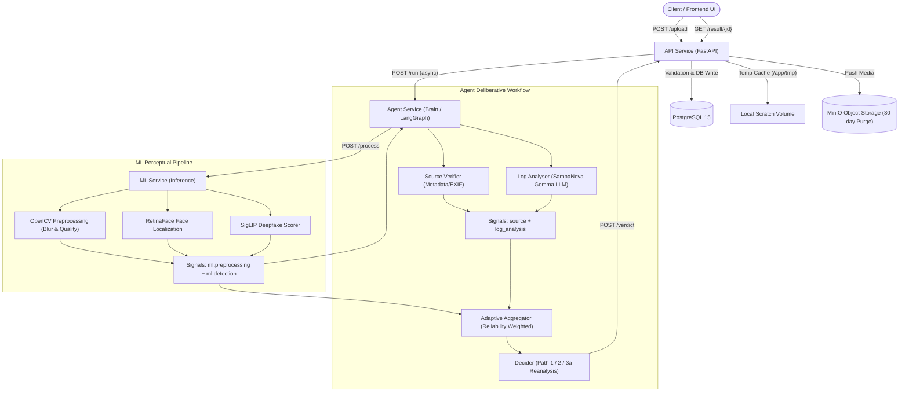

<div align="center">

# 🛡️ Deepfake Agentic AI
### *Autonomous Multi-Agent Forensics & Computer Vision for Synthetic Media Detection*

[](https://github.com/Santhosh-p653/deepfake-agentic-ai/actions/workflows/ci-api.yml)
[](https://github.com/Santhosh-p653/deepfake-agentic-ai/actions/workflows/ci-agents.yml)
[](https://github.com/Santhosh-p653/deepfake-agentic-ai/actions/workflows/ci-ml.yml)
[](https://python.org)
[](https://fastapi.tiangolo.com)
[](https://pytorch.org)
[](https://huggingface.co)
[](https://docker.com)
[](LICENSE.md)

<p align="center">
  <b>Enterprise-grade, distributed forensic analysis pipeline combining Vision Transformers (SigLIP), RetinaFace localization, and LangGraph-powered Agentic Workflows for automated deepfake and synthetic media verification.</b>
</p>

[Quick Start](#-getting-started) • [System Architecture](#-system-architecture--workflow) • [API Reference](#-api-endpoints) • [Signal Contract](#-signal-contract) • [Cognitive Roadmap](docs/roadmap.md) • [Case Studies](docs/casestudy/README.md)

</div>

---

## 📑 Table of Contents

- [🔍 Overview & Problem Statement](#-overview--problem-statement)
- [⚡ Key Features & Architectural Novelty](#-key-features--architectural-novelty)
- [📊 Architectural Comparison: Why Agentic AI?](#-architectural-comparison-why-agentic-ai)
- [🏗️ System Architecture & Workflow](#-system-architecture--workflow)
- [🚀 Getting Started](#-getting-started)
- [🌐 Services & URLs](#-services--urls)
- [📡 API Endpoints](#-api-endpoints)
- [🗄️ Media Pipeline & File Lifecycle](#-media-pipeline--file-lifecycle)
- [🗃️ Database Schema](#-database-schema)
- [📦 Object Storage — MinIO](#-object-storage--minio)
- [🧠 Signal Contract & Dynamic Aggregation](#-signal-contract)
- [🤖 Agent Decision Logic](#-agent-service--decision-logic)
- [📋 Structured Logging](#-structured-logging)
- [🧪 Evaluation Pipeline & Benchmarks](#-evaluation-pipeline)
- [🔬 Case Studies & Research Applications](#-case-studies--research-applications)
- [🛠️ Implementation Status & Roadmap](#-implementation-status)
- [🔬 CI/CD Workflows](#-ci-workflows)
- [🏷️ GitHub Topics & Keywords](#-seo-topics--keywords)
- [📜 Citation & License](#-citation--license)

---

## 🔍 Overview & Problem Statement

As generative diffusion models, GANs, and neural rendering tools produce hyper-realistic synthetic media, traditional single-pass computer vision classifiers (such as XceptionNet or MesoNet) increasingly fail due to:
1. **High false positive rates** under real-world compression, social media resizing, and novel generative signatures.
2. **Zero explainability**, providing black-box scalar probabilities without forensic justifications.
3. **Single-point-of-failure vulnerabilities**, lacking contextual, metadata, or frequency-domain verification.

**Deepfake Agentic AI** solves this by formulating synthetic media detection as an **adaptive, multi-signal forensic ecosystem**. It pairs deep computer vision feature extractors with autonomous LLM reasoning agents that inspect image quality, assess metadata provenance, cross-examine perceptual signals, and adaptively weight evidence at runtime.

> 🗺️ **Roadmap Spotlight:** We are actively evolving this system into a **Dual-Process Cognitive Architecture (System 1 Perceptual Triage + System 2 Multi-Agent Forensics)** with conformal uncertainty estimation to fast-exit clean media in $<100\text{ms}$ and deliberate on ambiguous edge cases. Read the full specification in [docs/roadmap.md](file:///home/santhosh/deepfake-agentic-ai/docs/roadmap.md).

---

## ⚡ Key Features & Architectural Novelty

- **🎯 RetinaFace & Vision Transformer Detection:** High-precision facial bounding box localization via RetinaNetMobileNetV1 coupled with `SiglipForImageClassification` for fine-grained face forgery scoring.
- **🧠 Dynamic Reliability-Weighted Aggregation:** Signals are weighted adaptively at runtime based on empirical reliability factors (e.g., face coverage ratio, compression artifacts, blur variance) rather than static heuristics.
- **🤖 LLM Forensic Reasoning:** SambaNova Gemma LLM continuously audits execution logs and forensic anomalies, formulating explainable reasoning traces rather than opaque labels.
- **🛡️ Source & Provenance Verification:** Pure-Python metadata and container verification verifying EXIF integrity, C2PA standards, and format consistency.
- **⚡ Dual-Process Cognitive Triage:** Fast perceptual screening (System 1) combined with uncertainty-gated multi-agent debate (System 2).
- **📦 Ephemeral Privacy-Preserving Storage:** Zero data hoarding. MinIO S3 object storage enforces automated 30-day lifecycle auto-purge policies.
- **📊 Real-Time Streamlit Dashboard:** User-friendly, forensic analysis UI with confidence breakdowns, log diagnostics, and audit paths.

---

## 📊 Architectural Comparison: Why Agentic AI?

| Forensic Dimension | Traditional Classifiers (CNN / ViT) | Standalone Multimodal LLMs (GPT-4o / Gemini) | **Deepfake Agentic AI (Our Platform)** |
| :--- | :--- | :--- | :--- |
| **Inference Latency** | Fast (~50ms) | Slow (2–8s) | **Fast Exit (<100ms) with Adaptive Agent Escalation** |
| **Explainable Audit Log** | ❌ None (raw float output) | ⚠️ Generic textual summary | **✅ Forensic trace + weighted signal breakdown** |
| **Out-of-Distribution Generalization** | ❌ Poor (overfits to train generators) | ⚠️ Moderate (susceptible to visual hallucinations) | **✅ Robust (Multi-signal cross-examination + metadata)** |
| **Metadata & Provenance Check** | ❌ None | ❌ Limited / None | **✅ Dedicated Source Verification Agent** |
| **Cost & Token Efficiency** | High (local GPU) | Prohibitive at scale | **Adaptive (LLM invoked only when uncertainty is high)** |

---

## 🏗️ System Architecture & Workflow

The system is deployed as an isolated microservices mesh over an internal Docker bridge network:



---

## 🚀 Getting Started

### 📋 Prerequisites

- **Docker & Docker Compose** (v24.0+)
- **Git** installed and configured
- **NVIDIA GPU + Container Toolkit** *(Optional, recommended for high-throughput inference)*

---

### ⚙️ Installation & Deployment

```bash
# 1️⃣ Clone the repository
git clone https://github.com/Santhosh-p653/deepfake-agentic-ai.git
cd deepfake-agentic-ai

# 2️⃣ Configure environment variables
cp .env.example .env
# Fill in SAMBANOVA_API_KEY, DATABASE_URL, MINIO credentials

# 3️⃣ Start the full multi-service mesh
docker compose up -d --build

# 4️⃣ Wipe volumes and perform a clean dev reset (if needed)
docker compose down -v && docker compose up --build
```

> **Note:** Service startup is healthcheck-gated. PostgreSQL and MinIO initialize and pass readiness checks before the API and Agent containers start.

---

## 🌐 Services & URLs

| Service | Port / URL | Description |
| :--- | :--- | :--- |
| **UI (Streamlit)** | [http://localhost:8501](http://localhost:8501) | Interactive forensic analysis & verdict dashboard |
| **API Service** | [http://localhost:8000](http://localhost:8000) | Core FastAPI orchestration & REST gateway |
| **API Documentation** | [http://localhost:8000/docs](http://localhost:8000/docs) | Auto-generated OpenAPI / Swagger UI |
| **ML Service** | `http://ml:8001` *(Internal)* | Preprocessing, face detection, SigLIP inference |
| **Agent Service** | `http://agents:8123` *(Internal)* | Multi-agent coordination, log analysis, signal decider |
| **MinIO Console** | [http://localhost:9001](http://localhost:9001) | S3 Object browser (`deepfakemedia` bucket) |
| **Dozzle** | [http://localhost:8080](http://localhost:8080) | Live Docker container log viewer |
| **Beszel** | [http://localhost:8090](http://localhost:8090) | Resource usage & container metrics dashboard |

---

## 📡 API Endpoints

### 🩺 System Diagnostics

| Method | Endpoint | Description |
| :--- | :--- | :--- |
| `GET` | `/ping` | Service liveness probe — returns `pong` |
| `GET` | `/health` | Deep healthcheck — verifies PostgreSQL connection |
| `GET` | `/run-agents` | Verifies agent cluster responsiveness |

---

### 📤 Media Ingestion & Verdicts

#### 1. Upload Media for Analysis
`POST /upload`  
**Accepted Formats:** `.jpeg`, `.png`, `.mp4` (Magic bytes and MIME validated)

```bash
curl -X POST http://localhost:8000/upload \
  -F "file=@/path/to/media.jpg"
```

**Success Response (`200 OK`):**
```json
{
  "status": "accepted",
  "record_id": 1,
  "filename": "media.jpg",
  "size_mb": 0.452,
  "minio_object": "a1b2c3d4-e5f6.jpg"
}
```

---

#### 2. Poll Detection Verdict
`GET /result/{id}`

```bash
curl http://localhost:8000/result/1
```

**Completed Response (`200 OK`):**
```json
{
  "id": 1,
  "filename": "media.jpg",
  "status": "completed",
  "verdict": "REAL",
  "verdict_score": 0.21,
  "uploaded_at": "2026-04-25T10:00:00Z",
  "processed_at": "2026-04-25T10:00:05Z"
}
```

**Possible Verdicts:** `REAL` · `FAKE` · `FLAG_FOR_REVIEW`

---

## 🗄️ Media Pipeline & File Lifecycle

Strict, privacy-first storage lifecycle with bounded temporary storage:

```
Upload → Validate Magic Bytes → Write to /app/tmp (Max 2 files cap) → ML & Agent Processing → MinIO Object Storage → Auto-Purge at 30 Days
```

| Lifecycle Stage | DB Status | Operational Description |
| :--- | :--- | :--- |
| **Received** | `pending` | Upload accepted, DB record locked |
| **Staged** | `temp_stored` | File written to isolated `/app/tmp` scratch directory |
| **Analyzing** | `processing` | ML service runs face detection and SigLIP inference |
| **Archived** | `processed` | Inference complete; media pushed to MinIO S3 bucket |
| **Scrubbed** | `deleted` | Scratch file permanently deleted from `/app/tmp` |
| **Resolved** | `completed` | Verdict and confidence scores persisted in database |
| **Exception** | `failed` | Failure at any pipeline phase logged with RFC 7807 problem details |

---

## 🗃️ Database Schema

**Primary Table: `media_uploads`**

| Column | Type | Constraints | Description |
| :--- | :--- | :--- | :--- |
| `id` | `Integer` | Primary Key, Auto-increment | Unique media record identifier |
| `user_id` | `Integer` | Nullable | Optional user or client identity |
| `filename` | `String` | Not Null | Original filename |
| `file_type` | `String` | Not Null | Normalized file extension |
| `size_mb` | `Float` | Not Null | Payload size in megabytes |
| `status` | `Enum` | `pending` .. `completed` | State machine pipeline status |
| `temp_path` | `String` | Nullable | Ephemeral scratch file path |
| `drive_path` | `String` | Nullable | MinIO S3 object key |
| `verdict` | `String` | Nullable | Final verdict (`REAL` / `FAKE` / `FLAG_FOR_REVIEW`) |
| `verdict_score` | `Float` | Nullable | Final aggregated probability ($0.0 \dots 1.0$) |
| `uploaded_at` | `DateTime` | UTC Timestamp | Ingestion timestamp |
| `processed_at` | `DateTime` | UTC Timestamp | Completion timestamp |

---

## 📦 Object Storage — MinIO

- **Target Bucket:** `deepfakemedia`
- **Lifecycle Policy:** 30-day automatic deletion rule enforced by S3 bucket policy.
- **Access Control:** Short-lived presigned URLs (24-hour expiration) generated for authorized inspection.
- **Credentials:** Managed via `.env` (`MINIO_ACCESS_KEY` / `MINIO_SECRET_KEY`).

---

## 🧠 Signal Contract

All analytical components emit standardized, schema-locked `Signal` objects:

```json
{
  "score": 0.87,
  "reliability": 0.92,
  "module": "ml.detection",
  "metadata": {
    "num_faces": 1,
    "face_coverage": 0.43,
    "model": "prithivMLmods/deepfake-detector-model-v1"
  }
}
```

### Active Forensic Signals

| Signal Module | Source Mechanism | Reliability Calculation |
| :--- | :--- | :--- |
| `ml.detection` | RetinaFace + SigLIP ViT | Scaled dynamically by face coverage ratio ($A_{\text{face}} / A_{\text{frame}}$) |
| `ml.preprocessing` | Laplacian blur variance & resolution checks | Clamped gate based on image sharpness thresholds |
| `agents.source_verifier` | EXIF & provenance analysis | Deterministic score ($0.80$ baseline) |
| `agents.log_analyser` | Gemma LLM (SambaNova Cloud) | Calibrated based on anomaly confidence |

---

## 🤖 Agent Service — Decision Logic

The Aggregator synthesizes all active signals into a weighted score:

$$\text{Score}_{\text{agg}} = \sum_{i=1}^N \left( s_i \cdot \frac{r_i}{\sum_j r_j} \right)$$

### Decision Tree Paths

| Path | Condition | Result | Action |
| :--- | :--- | :--- | :--- |
| **Path 1** | $\text{Score} \ge 0.70$ | `FAKE` | Media flagged as manipulated with high confidence |
| **Path 2** | $\text{Score} \le 0.30$ | `REAL` | Media verified as authentic with high confidence |
| **Path 3a** | $0.45 \le \text{Score} \le 0.55$ | `FLAG_FOR_REVIEW` | Deep middle zone: triggers uniform weight boost reanalysis |
| **Path 3b** | Inter-module conflict ($\ge 70/30$) | `FLAG_FOR_REVIEW` | Conflict reanalysis adjusting conflicting module weights |

**Governance Constraints:**
- Maximum **one** reanalysis pass per record ID (enforced via in-memory lock).
- LLMs provide forensic context and explainability, but mathematical thresholding governs verdicts.

---

## 📋 Structured Logging

All services emit machine-readable structured JSON to stdout and `logs/app.log`:

```json
{
  "timestamp": "2026-04-25T10:45:00.123Z",
  "level": "INFO",
  "module": "ml.detection",
  "status": "success",
  "message": "Detection model inference completed",
  "record_id": 1,
  "score": 0.87,
  "reliability": 0.92
}
```

---

## 🧪 Evaluation Pipeline

Automated testing framework evaluating detection quality against a balanced subset of the **[140k Real and Fake Faces](https://www.kaggle.com/datasets/xhlulu/140k-real-and-fake-faces)** benchmark.

```bash
# 1. Unpack evaluation fixtures
unzip tests/fixtures/deepfake_subset.zip -d tests/fixtures/

# 2. Run test database migration
docker compose exec api psql $DATABASE_URL -f /app/tests/migrations/001_create_test_fixtures.sql

# 3. Seed ground-truth labels
docker compose exec api python /app/tests/fixtures/seed_db.py

# 4. Execute precision, recall, and F1 evaluation runner
docker compose exec api python /app/tests/eval/evaluate.py
```

---

## 🔬 Case Studies & Research Applications

Explore five in-depth forensic investigations analyzing real-world deepfake attack vectors, academic research benchmarks, and how this architecture resolves each threat:

| Case Study | Focus Area | Real-World Scenario | Key Research Sources |
| :--- | :--- | :--- | :--- |
| **[Case Study 01](docs/casestudy/casestudy01.md)** | **Identity Swapping** | $25M HK Executive Video Teleconference Wire Fraud | *FaceForensics++* (ICCV), *DFDC*, *DeepAgent* |
| **[Case Study 02](docs/casestudy/casestudy02.md)** | **Diffusion Portraits** | Viral Social Media Election Misinformation (Midjourney / Flux) | *Corvi et al.* (ICASSP), *Ojha et al.* (CVPR) |
| **[Case Study 03](docs/casestudy/casestudy03.md)** | **Facial Inpainting** | Non-Consensual Imagery & Mask Boundary Blending (RoOP) | *Face X-Ray* (CVPR), *Nirkin et al.* (TPAMI) |
| **[Case Study 04](docs/casestudy/casestudy04.md)** | **Compression Laundering** | Social Media Re-Compression Evasion (WhatsApp, TikTok, X) | *Frank et al.* (ICML), *Durall et al.* (CVPRW) |
| **[Case Study 05](docs/casestudy/casestudy05.md)** | **Regulatory & Provenance** | EU AI Act (Art. 50) & Courtroom Evidence Admissibility (FRE 901) | *C2PA Spec v2.0*, *NIST SP 800-86*, *RFC 7807* |

👉 *Read the full case study series and comparative matrix in [docs/casestudy/README.md](docs/casestudy/README.md).*

---

## 🛠️ Implementation Status

### Phase 1 — Ingestion & Storage Pipeline ✅
- [x] Strict magic-byte and encoding validation (`input_validator.py`)
- [x] PostgreSQL ORM schemas and transactional locks
- [x] Ephemeral scratch storage with concurrency caps
- [x] MinIO S3 integration with 30-day automatic object expiration
- [x] Structured JSON logging with automated CI schema enforcement

### Phase 2 — Multi-Signal Agentic Core ✅
- [x] Pydantic v2 `Signal` contract across microservices
- [x] Preprocessing quality evaluation (Laplacian blur variance)
- [x] SambaNova Gemma LLM forensic log analyzer with fallback caching
- [x] Metadata provenance verifier
- [x] Dynamic reliability-weighted aggregator & threshold decider
- [x] Streamlit real-time forensic dashboard

### Phase 3 — Detection & Benchmarking 🔄
- [x] PyTorch RetinaFace face localization
- [x] Hugging Face `prithivMLmods/deepfake-detector-model-v1` SigLIP inference
- [x] 140k dataset benchmarking runner (`evaluate.py`)
- [ ] Threshold optimization and ROC tuning *(In Progress)*

### Phase 4 — Dual-Process Cognitive Forensics (System 1 + System 2) 🔜 Planned
- [ ] **System 1 Decision Head:** Spatial SigLIP + FFT frequency residual filter fusion
- [ ] **Cognitive Gatekeeper:** Sub-100ms fast-path exit for high-certainty media ($P > 0.85$ or $P < 0.15$)
- [ ] **Uncertainty-Gated Escalation:** Route ambiguous samples ($0.30 \le s \le 0.70$) to System 2
- [ ] **System 2 Multi-Agent Debate:** LangGraph state machine with adversarial prosecutor/advocate agents
- [ ] **Metacognitive Feedback Loop:** Continuous calibration from deliberated edge cases

*For full roadmap milestones, see [docs/roadmap.md](file:///home/santhosh/deepfake-agentic-ai/docs/roadmap.md).*

---

## 🔬 CI Workflows

Automated GitHub Actions running parallel validation matrices on every pull request to `main`:

| Workflow File | Verification Scope | Status |
| :--- | :--- | :--- |
| `ci-api.yml` | Linting (Black, isort, flake8), Docker build & GHCR publish | [](https://github.com/Santhosh-p653/deepfake-agentic-ai/actions/workflows/ci-api.yml) |
| `ci-agents.yml` | Agent linting, type checks, Docker build & GHCR publish | [](https://github.com/Santhosh-p653/deepfake-agentic-ai/actions/workflows/ci-agents.yml) |
| `ci-ml.yml` | ML unit tests (mocked PyTorch/SigLIP models), build & push | [](https://github.com/Santhosh-p653/deepfake-agentic-ai/actions/workflows/ci-ml.yml) |
| `ci-tests.yml` | End-to-end integration tests with PostgreSQL service | [](https://github.com/Santhosh-p653/deepfake-agentic-ai/actions/workflows/ci-tests.yml) |
| `ci-network-audit.yml` | Live network audit, container isolation, log format validation | Passed |

---

## 🏷️ SEO Topics & Keywords

Recommended GitHub repository topics for enhanced discoverability:

`deepfake-detection` • `agentic-ai` • `synthetic-media-detection` • `ai-safety` • `computer-vision` • `vision-transformer` • `siglip` • `retinaface` • `langgraph` • `fastapi` • `pytorch` • `multimodal-ai` • `c2pa-provenance` • `media-forensics` • `system-1-system-2` • `conformal-prediction`

---

## 📜 Citation & License

If you use this architecture or codebase in your research or production systems, please cite:

```bibtex
@software{deepfake_agentic_ai_2026,
  author = {Santhosh and Contributors},
  title = {Deepfake Agentic AI: Autonomous Multi-Agent Forensics & Computer Vision for Synthetic Media Detection},
  year = {2026},
  publisher = {GitHub},
  journal = {GitHub repository},
  howpublished = {\url{https://github.com/Santhosh-p653/deepfake-agentic-ai}}
}
```

Distributed under the **MIT License**. See [LICENSE.md](LICENSE.md) for full terms.
