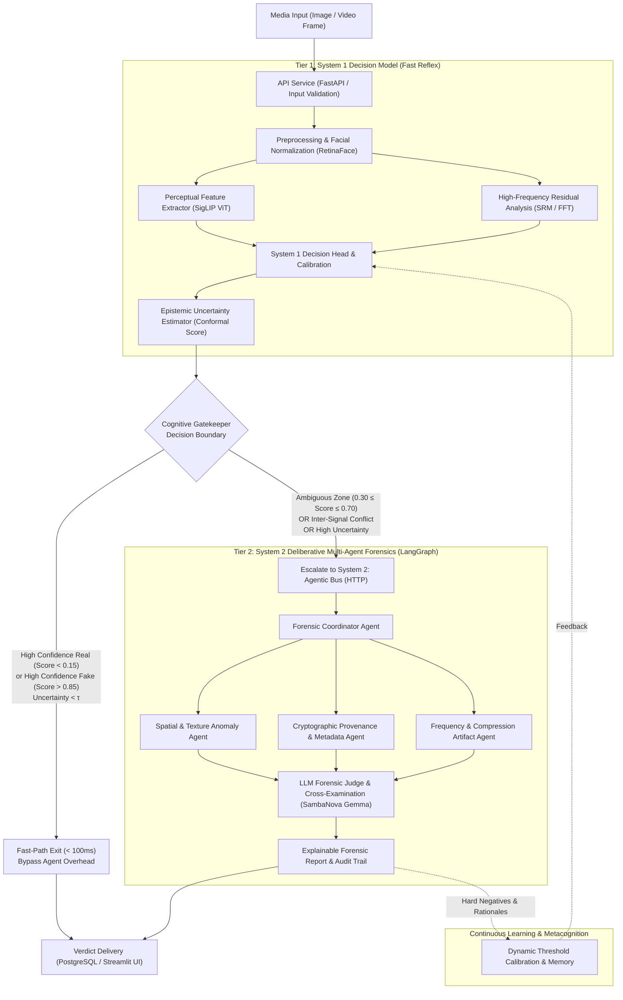

# 🗺️ Architecture Roadmap — Dual-Process Cognitive Forensics (System 1 + System 2)

## 📌 Executive Overview

This document outlines the strategic engineering and research roadmap for evolving the **Deepfake Agentic AI** platform into a **Dual-Process Cognitive Architecture** (inspired by Daniel Kahneman's Dual-Process Theory).

As synthetic generation (diffusion, flow-matching, GANs) becomes increasingly photorealistic, pure perceptual classifiers (System 1 alone) suffer from high out-of-distribution false positives, while pure agentic multi-modal LLM pipelines (System 2 alone) introduce unacceptable latency ($>5\text{s}$) and compute overhead. 

This roadmap introduces a **hierarchical, uncertainty-gated decision pipeline**:
1. **System 1 (Perceptual Reflex / Decision Model):** High-throughput, sub-second inference via lightweight Vision Transformers (SigLIP) and frequency-domain artifact extractors with calibrated confidence scoring.
2. **Cognitive Gatekeeper (Uncertainty & Divergence Routing):** Automatically settles unambiguous samples ($<100\text{ms}$) and routes ambiguous, high-entropy, or conflicting media to System 2.
3. **System 2 (Deliberative Multi-Agent Forensics):** Coordinated multi-agent cross-examination (LangGraph + SambaNova Gemma LLM + C2PA provenance + frequency analysis) producing an explainable forensic verdict.

---

## 🏛️ Target Architectural Blueprint



---

## 🔬 Core Technical Components

### 1. System 1 Decision Model (Perceptual Reflex Layer)
* **Goal:** High-throughput, deterministic classification for $\ge 75\%$ of clean or obvious inputs with $<100\text{ms}$ latency.
* **Architecture:**
  * **Primary Perceptual Backbone:** Fine-tuned `SiglipForImageClassification` / ViT for face-crop artifact detection.
  * **Frequency Residual Head:** Steganalysis Rich Model (SRM) filter or Fast Fourier Transform (FFT) high-pass filtering to detect synthetic grid artifacts and checkerboard patterns invisible in spatial RGB.
  * **Decision Head:** Calibrated temperature-scaled logistic regression or shallow Gradient Boosted Decision Tree (GBDT) producing:
    $$\hat{y} \in [0.0, 1.0], \quad \mathcal{U} \in [0.0, 1.0]$$
    where $\hat{y}$ is the synthetic probability and $\mathcal{U}$ is the epistemic uncertainty.

### 2. Cognitive Gatekeeper & Uncertainty-Aware Routing
* **Goal:** Prevent unnecessary agent invocation and eliminate latency bottlenecks while ensuring 0% compromise on forensic rigor.
* **Mathematical Routing Rule:**
  Let $s_1$ be the System 1 detection score and $u_1$ be its epistemic uncertainty metric (derived via conformal prediction bounds or Dirichlet evidential distribution).
  * **Condition for Fast Real Exit:** $s_1 \le \theta_{\text{real}}$ AND $u_1 < \tau$
  * **Condition for Fast Fake Exit:** $s_1 \ge \theta_{\text{fake}}$ AND $u_1 < \tau$
  * **Escalation Trigger:** 
    $$\theta_{\text{real}} < s_1 < \theta_{\text{fake}} \quad \lor \quad u_1 \ge \tau \quad \lor \quad |s_{\text{spatial}} - s_{\text{freq}}| > \delta$$
  * When triggered, an asynchronous event is dispatched to the `agents` service with all pre-extracted perceptual features, avoiding redundant re-computation.

### 3. System 2 Deliberative Multi-Agent Forensics
* **Goal:** In-depth, explainable forensic reasoning for complex, adversarial, or ambiguous media.
* **Agent Topology (LangGraph):**
  * **Forensic Coordinator:** Manages the investigation lifecycle, tracks hypothesis trees, and assigns verification sub-tasks.
  * **Visual & Anatomical Inspector:** Investigates corneal reflections, pupil circularity, dental boundaries, and facial boundary blend lines.
  * **Provenance & Metadata Agent:** Inspects EXIF signatures, camera maker notes, quantization tables, and C2PA cryptographic manifests.
  * **Forensic Judge (SambaNova Gemma):** Synthesizes conflicting evidence, applies Bayesian evidence weighting, and generates an auditable, legally-defensible narrative explanation.

---

## 📚 Prior Art & Academic Landscape

| Framework / Paper | Core Focus | Comparison with Deepfake Agentic AI |
| :--- | :--- | :--- |
| **Multi-Agent Forensic Reasoning** (*arXiv:2608.06865, 2026*) | 4 specialized domain agents (texture, lighting, motion, physics) + judge. | Focuses purely on agentic video analysis. Does not implement a fast System 1 early-exit triage gatekeeper. |
| **DeepAgent** (*arXiv:2512.07351, 2025*) | Dual-stream multi-agent fusion for audio-visual media. | Fuses multi-modal streams via meta-classifier; our roadmap explicitly decouples fast perceptual screening from slow reasoning. |
| **TruEDebate / TED** (*arXiv:2505.08532, 2025*) | Multi-agent debate (DebateFlow vs. InsightFlow) for synthetic media. | Focuses on discursive LLM debates; our System 2 adopts debate-style cross-examination for ambiguous edge cases. |
| **DF-P2E (Prediction to Explanation)** | Feature extraction coupled with MLLM narrative rationale generation. | Aligns with our structured Signal Contract and explainability outputs. |

---

## 🗓️ Phased Implementation Milestones

```
Phase 3 (Current) ──────► Phase 4.1 ──────────────► Phase 4.2 ──────────────► Phase 4.3 ──────────────► Phase 4.4
Evaluation & Tuning       System 1 Decision Head     Cognitive Gatekeeper      Multi-Agent Debate         Continuous Calibration
• Kaggle 140k dataset     • Dual-backbone (SigLIP+   • Calibrated fast-path    • LangGraph multi-agent    • Hard-negative feedback
• Precision / Recall / F1   Frequency FFT)             short-circuit (<100ms)    debate structure           • Autonomous threshold
• Threshold optimization  • Signal contract v2       • Latency/cost audit      • Explainable PDF reports    re-weighting
```

### Milestone 4.1: System 1 Decision Model Enhancement
- [ ] Add frequency-domain feature extraction (`ml/frequency.py` via 2D-FFT and high-pass residual filters).
- [ ] Implement multi-feature Decision Head combining spatial SigLIP features with frequency anomalies.
- [ ] Enhance `shared/signal.py` to support `uncertainty` and `confidence_interval` fields.

### Milestone 4.2: Cognitive Gatekeeper & Fast-Path Short-Circuiting
- [ ] Implement fast-path evaluation in `api/` or `agents/decider.py`.
- [ ] Route definitive predictions ($>0.85$ or $<0.15$) directly to DB and MinIO, bypassing agent orchestration.
- [ ] Add Prometheus/Beszel metrics tracking System 1 vs. System 2 invocation ratio, average latency, and token cost savings.

### Milestone 4.3: LangGraph System 2 Multi-Agent Debate
- [ ] Refactor `agents/` service into a formal LangGraph state machine with specialized investigator agents.
- [ ] Implement adversarial debate between an **Advocate Agent** (proving authenticity) and a **Prosecutor Agent** (proving forgery).
- [ ] Generate structured forensic reasoning logs and Markdown/PDF executive reports.

### Milestone 4.4: Metacognitive Calibration & Continual Adaptation
- [ ] Build a hard-negative sample store in MinIO for cases where System 1 was uncertain but System 2 delivered high confidence.
- [ ] Implement dynamic threshold adjustment based on continuous validation batch performance.
